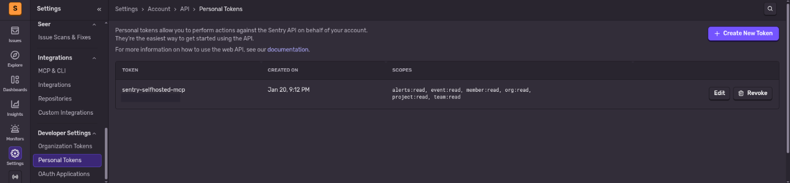
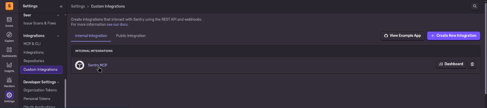
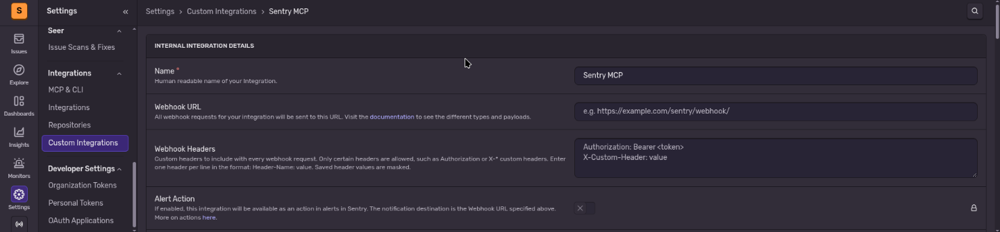
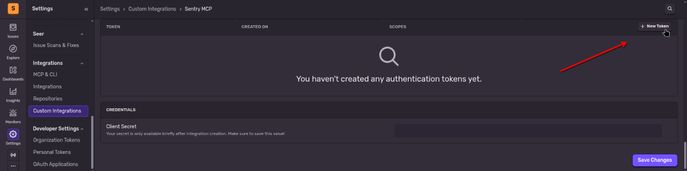
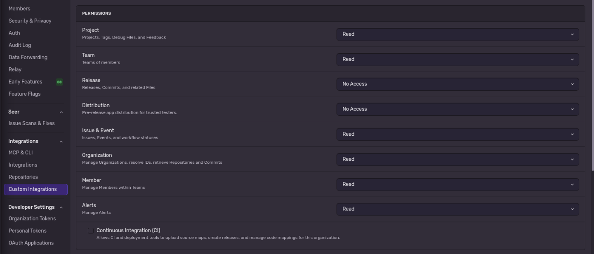
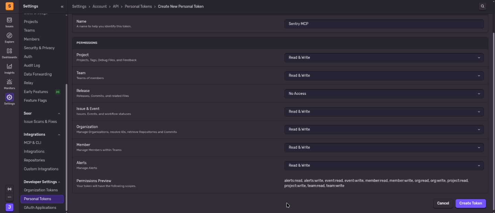

# Streaming Tech Sentry MCP

Connect an MCP client to Sentry over Streamable HTTP. Investigate issues, events, logs, traces, metrics and profiles, and manage projects, teams, membership, alerts, monitors and SDK keys. The service discovers the token's permissions and exposes the tools those permissions allow.

The project uses the official [Sentry toolkit](https://github.com/getsentry/toolkit), with compatibility handling for self-hosted Sentry. It runs in Docker as a non-root user and requires no persistent storage.

## Requirements

- Docker Engine with Docker Compose.
- A reachable Sentry installation, its organisation slug and an API token.
- An MCP client supporting Streamable HTTP.
- Network access to Sentry and GHCR. Optional release detection also contacts `api.github.com`; source builds need GitHub and package-registry access.

The supported self-hosted Sentry range is **26.7.2 through 26.10.1**. Compatibility fixtures and source review cover this range; deployment checks have exercised 26.7.2 and 26.8.0. Logs, profiling, monitors and other features also depend on your Sentry configuration and collected data.

## Create a Sentry token

Create a token on the Sentry installation you want to connect to. Choose the access level from the permission tables below and save the generated token as `SENTRY_ACCESS_TOKEN`.

| Token type                  | Recommended use                     | Identity and access                                               |
| --------------------------- | ----------------------------------- | ----------------------------------------------------------------- |
| Personal access token (PAT) | Your laptop, PC or personal sidecar | Acts as your Sentry account, with its organisation/project access |
| Internal integration token  | A shared server or unattended agent | Acts as an integration installed in one Sentry organisation       |

Both types support permission discovery. Some user-specific endpoints require a personal token. See Sentry's [authentication reference](https://docs.sentry.io/api/auth/) and [internal integration setup](https://docs.sentry.io/api/guides/create-auth-token/).

### Create a personal token

1. Open **Settings → Developer Settings → Personal Tokens** and select **Create New Token**.
2. Give it a name, such as `Sentry MCP`, and select the permissions from the appropriate table below. The permissions preview shows the resulting API scopes.
3. Select **Create Token** and copy the generated token to your secret store.



### Create an internal integration token

1. Select the intended organisation and open **Settings → Custom Integrations → Create New Integration**. Choose **Internal Integration**.
2. Name it `Sentry MCP` and select the permissions from the appropriate table below. Leave the webhook fields empty and keep **Alert Action** and webhook subscriptions disabled.
3. Select **Save Changes** and open the saved integration.
4. In the token section, select **New Token**. Copy the generated **Token** to your secret store while its full value is displayed.







Use the value created by **New Token** for `SENTRY_ACCESS_TOKEN`.

### Inspection token

Use this for investigating issues, errors, logs, traces, metrics and profiles, and reading project/team/release metadata. It exposes tools such as `search_issues`, `get_issue_details`, `search_logs`, `search_profiles` and `get_profile_details`. Use `find_members`, `find_team_members`, `find_alert_rules` and `get_alert_rule` for member and alert reads. Not every tool needs all six read scopes.

The rows follow the permission order in Sentry's integration form. **Continuous Integration (CI)** is a checkbox rather than a permission dropdown.

| Sentry permission           | Select    | API scope      |
| --------------------------- | --------- | -------------- |
| Project                     | Read      | `project:read` |
| Team                        | Read      | `team:read`    |
| Release                     | No Access | —              |
| Distribution                | No Access | —              |
| Issue & Event               | Read      | `event:read`   |
| Organization                | Read      | `org:read`     |
| Member                      | Read      | `member:read`  |
| Alerts                      | Read      | `alerts:read`  |
| Continuous Integration (CI) | Unchecked | —              |



### Issue-management token

Use this when the agent should investigate issues and assign, unassign, resolve, reopen or change their priority. In addition to inspection tools, `update_issue` becomes available automatically when the token grants `event:write` or `event:admin`. No extra project/team write permission is needed for assigning an issue to an existing user or team.

| Sentry permission           | Select       | API scopes                  |
| --------------------------- | ------------ | --------------------------- |
| Project                     | Read         | `project:read`              |
| Team                        | Read         | `team:read`                 |
| Release                     | No Access    | —                           |
| Distribution                | No Access    | —                           |
| Issue & Event               | Read & Write | `event:read`, `event:write` |
| Organization                | Read         | `org:read`                  |
| Member                      | Read         | `member:read`               |
| Alerts                      | Read         | `alerts:read`               |
| Continuous Integration (CI) | Unchecked    | —                           |

Keep the inspection settings and change only **Issue & Event** to **Read & Write**. The same token can support both investigation and issue updates; its organisation/project access still limits the targets. See the [issue-update API](https://docs.sentry.io/api/events/update-an-issue/) for Sentry's requirements.

### Project-management token

Use this when the agent should also configure projects, teams, team membership, alerts, monitors and public SDK keys. Tools are exposed individually according to the token's scopes. The table below gives a broad management configuration. A token restricted to selected write categories exposes only the tools those categories permit.

Sentry still enforces the token owner's role, organisation access, Open Membership and identity-provider restrictions. A tool being listed confirms its token-scope requirements, not that every resource or operation is available. See Sentry's [permission reference](https://docs.sentry.io/api/permissions/) and [team-membership API](https://docs.sentry.io/api/teams/add-an-organization-member-to-a-team/).

| Sentry permission           | Select       | API scopes                      |
| --------------------------- | ------------ | ------------------------------- |
| Project                     | Read & Write | `project:read`, `project:write` |
| Team                        | Read & Write | `team:read`, `team:write`       |
| Release                     | No Access    | —                               |
| Distribution                | No Access    | —                               |
| Issue & Event               | Read & Write | `event:read`, `event:write`     |
| Organization                | Read & Write | `org:read`, `org:write`         |
| Member                      | Read         | `member:read`                   |
| Alerts                      | Read & Write | `alerts:read`, `alerts:write`   |
| Continuous Integration (CI) | Unchecked    | —                               |

Select the permissions in the table above. Team-membership changes use member and organisation read access plus either team or organisation write/admin permission.



See the [tools guide](docs/tools.md) for available tools, access levels, required permissions and arguments.

## Configure Docker

Use the image `ghcr.io/streaming-tech/sentry-mcp:latest`, published from [Streaming-Tech/sentry-mcp](https://github.com/Streaming-Tech/sentry-mcp).

Create a `.env` file next to your Compose file:

```dotenv
SENTRY_HOST=sentry.example.com
SENTRY_ORG_SLUG=example-org
SENTRY_ACCESS_TOKEN=your-generated-token
```

Set `SENTRY_HOST` to the hostname, with an optional port. Obtain the organisation slug from your Sentry URL, for example `example-org` in `/organizations/example-org/`. Add `SENTRY_PROJECT_SLUG=example-project` to restrict operations to one project.

Keep `.env` private and outside source control. On Linux, use `chmod 600 .env`. Docker Compose reads it automatically and supplies the token to the container. To replace the token, edit `.env`, run `docker compose up -d` and reconnect your MCP client.

### Run on a Docker host

Use [docker-compose.yml](docker-compose.yml) when your MCP client runs on the host. It publishes the port on loopback so your host agent can connect to **`http://127.0.0.1:7013/mcp`**.

```bash
docker compose up -d
```

### Run as a sidecar

Use [docker-compose.sidecar.yml](docker-compose.sidecar.yml) when your agent runs in a Docker stack. Attach the agent to the template's private `mcp` network and connect to **`http://sentry-mcp:7013/mcp`**. This template keeps the MCP port on that network.

```bash
docker compose -f docker-compose.sidecar.yml up -d
```

The endpoint trusts connected clients. Keep access on loopback or a private agent network; use an authenticated TLS gateway for access from another host.

## Configuration

Configuration is read at startup. Recreate the container after changing its environment. Add settings to `.env` and run the selected Compose template.

| Variable                        | Default                 | Meaning                                                                                      |
| ------------------------------- | ----------------------- | -------------------------------------------------------------------------------------------- |
| `SENTRY_HOST`                   | Required                | Sentry hostname and optional port, without a scheme or path                                  |
| `SENTRY_ACCESS_TOKEN`           | Required                | Generated personal or internal integration Token                                             |
| `SENTRY_ORG_SLUG`               | Required                | Organisation constraint                                                                      |
| `SENTRY_PROJECT_SLUG`           | Unset                   | Optional project constraint                                                                  |
| `PORT`                          | `7013`                  | HTTP listening port; the Compose templates also use it for the host mapping and health check |
| `SENTRY_INSECURE_HTTP`          | `false`                 | Use HTTP to Sentry instead of HTTPS; only for an intentionally trusted local deployment      |
| `SENTRY_API_TIMEOUT_MS`         | `60000`                 | Request/operation timeout, from `1000` to `60000` ms                                         |
| `SENTRY_API_MAX_RESPONSE_BYTES` | `1048576`               | Response/probe limit, from `1024` to `10485760` bytes                                        |
| `SENTRY_API_MAX_PAGES`          | `5`                     | Generic API pagination limit, from `1` to `20`                                               |
| `SENTRY_API_MAX_ITEMS`          | `250`                   | Generic API item limit, from `1` to `1000`                                                   |
| `SENTRY_COMPAT_PROFILE`         | `auto`                  | Compatibility selection; normally leave automatic detection enabled                          |
| `SENTRY_MCP_REF`                | Image's pinned revision | Upstream source identity; keep the runtime value aligned with the image build                |

Boolean values must be `true` or `false`. Compatibility profile values are `auto`, `self-hosted-26.5`, `self-hosted-current`, `unknown-conservative` and `sentry-saas`. A profile override does not add unsupported API features or extend the tested version range. `SENTRY_MCP_REF` must be a full lowercase 40-character commit SHA; setting it at runtime does not download or replace the embedded source.

### Access modes

The sidecar queries authenticated `GET /api/0/` for `auth.scopes` before creating each MCP session. Personal tokens and internal integration tokens use the same discovery path; an integration token does not need an authenticated user record. Only implemented tools with satisfied scope requirements are advertised. Where supported by Sentry, write/admin scopes satisfy the corresponding read requirement, and release reads also accept release-specific alternatives.

For inspection, use the six recommended read scopes above. To enable issue management, additionally grant `event:write` and recreate the container if replacing its token. A token with issue-write permission automatically enables issue updates for all trusted clients of the sidecar.

`sentry_server_info` reports `tokenPermissions` (discovery status, granted scopes and check time) and derives `enabledSkills` from the discovered permissions. If permission discovery fails, only diagnostics and capability refresh tools are available. Discovery uses the configured response size limit and a timeout of at most five seconds. Concurrent discovery calls share a request. The token and returned user profile are excluded from diagnostics.

The advertised catalogue is selected when the client establishes its MCP session. Reconnect the client after changing integration permissions or recovering discovery to obtain the revised catalogue. Every non-diagnostic tool call checks the token's scopes. Issue updates check again before reading or writing the issue. Losing a grant or failing discovery blocks the call. Scopes establish eligibility, not guaranteed access to every resource: Sentry still enforces organisation membership, project access and feature availability.

Project-management tools follow the same permission and resource checks. Generic API fallbacks allow GET requests with the configured timeout, response size and pagination limits.

`update_issue` takes `issueId` (a numeric ID or short ID such as `PROJECT-123`) and at least one of:

- `status`: `resolved` or `unresolved` (reopen).
- `assignedTo`: `user:123`, `team:123`, `team:team-slug`, or `null` to unassign. Omit it to retain the current assignee. For a user, use the user ID returned under `user.id` in a member lookup, not the organisation membership ID.
- `priority`: `low`, `medium` or `high`.

Multiple changes are sent in one PUT, after a read verifies the issue belongs to the configured organisation and project. Only supplied fields are modified. The upstream request guard permits only the exact scoped issue update while it is executing. Writes are not retried and redirects are rejected. If an update times out or returns an error, read the issue before deciding whether to retry: the server may already have applied it. Resolving or reopening can trigger Sentry notifications and integrations.

## Connect and verify

Add the appropriate `/mcp` URL to your client's Streamable HTTP configuration. For a client running on the Docker host, a typical entry is:

```json
{
  "mcpServers": {
    "sentry": {
      "url": "http://127.0.0.1:7013/mcp"
    }
  }
}
```

Client configuration formats vary; use the sidecar URL instead when the client runs on its Docker network. The sidecar supplies Sentry authentication for connected clients.

1. Check container status with `docker compose ps` and request `curl --fail http://127.0.0.1:7013/health`. HTTP 200 means the wrapper is running; inspect `sentryReachability` and use the MCP checks below to establish upstream access.
2. Connect through your MCP client and list tools. Call `sentry_server_info` to confirm the wrapper version, embedded upstream revision, detected Sentry version and capability status. Call `refresh_sentry_capabilities` after correcting credentials or connectivity.
3. Find the intended project, search recent issues, and read one issue's details. Run a small log or profile query for a project known to collect that data, and retrieve a profile's details when a result exists. An empty successful query does not prove that ingestion is configured.

For a sidecar deployment, check `/health` from the shared client network; the example also provides a Docker health check. To inspect startup errors, use `docker compose logs --tail 50 sentry-mcp`. Redact credentials and event data before sharing logs.

## Tools and troubleshooting

Connected agents receive server instructions and tool input schemas. The `sentry-mcp://usage` resource lists the tools available to their session and explains how to choose between them.

Use dedicated tools such as `search_issues`, `get_issue_details`, `search_logs`, `search_traces`, `search_metrics`, `search_profiles` and `get_profile_details` first. Dataset searches use `period`. If a dedicated read cannot answer a question, inspect `sentry_server_info`, then use `sentry_api_get` or `sentry_api_paginate`. These fallbacks accept GET requests under `/api/0/` on the configured Sentry installation and enforce the organisation/project restrictions, timeout, response size and pagination limits. Agents must tell the operator when they use a fallback, explain which dedicated tool failed or could not answer, and ask the operator to check the MCP sidecar and Sentry logs.

| Symptom                             | Check                                                                                           |
| ----------------------------------- | ----------------------------------------------------------------------------------------------- |
| Startup fails                       | Required variables, hostname format and strict boolean/integer values; read the container logs  |
| Client cannot connect               | `/mcp` URL, service DNS, shared network and port binding                                        |
| Sentry returns 401/403              | Token validity, scopes, organisation membership and project access; Seer is disabled separately |
| Search succeeds but returns no data | Project, time range, dataset ingestion and retention                                            |
| Probe exceeds its response limit    | Increase `SENTRY_API_MAX_RESPONSE_BYTES` up to its allowed maximum, then refresh capabilities   |
| Probe times out                     | Connectivity and Sentry health; probes use up to 15 seconds or the lower API timeout            |
| Unknown Sentry version              | Review bootstrap metadata and outbound GitHub access; version detection is advisory             |
| Missing mutation tools              | Check `tokenPermissions`, grant the required token scopes and reconnect the client              |

Transaction-profile search defaults use columns supported across the target versions. Continuous profiles require a known `profilerId`, `start` and `end`; transaction-profile detail uses `profileId`. Route discovery alone does not establish dataset support. Long-lived GET notification streams remain open independently of the operation timeout.

Application-version detection reads Sentry's bootstrap metadata. If Sentry reports a commit SHA, the service looks up the release through GitHub's public tags API, checks at most five pages and caches the result. For installations without the alert project-scope endpoint, the service checks every detector attached to the workflow and its project before allowing project-specific operations. If those connections are incomplete, inaccessible or change during the check, the operation is refused.

## Build and development

Docker is the development environment. Run these commands from the project directory:

```bash
docker build --target test -t sentry-mcp:test .
docker build --target runtime -t ghcr.io/streaming-tech/sentry-mcp:latest .
```

The test target runs TypeScript, Biome and Vitest checks as part of the build, including tests as the non-root runtime user. The runtime target checks types and imports the application as that user. Start the local image with either Compose template and follow the connection checks above.

The image embeds a pinned revision of the official Sentry toolkit and uses locked dependencies. Keep compatibility fixtures alongside API adaptations. Tests use fixtures, so validate the deployment after rebuilding too.

## Licence

Copyright 2026 Streaming Tech. Licensed under the [Functional Source License, Version 1.1, Apache 2.0 Future License](LICENSE.md). Each version becomes available under Apache 2.0 two years after its release.

Sentry toolkit and the upstream code modified by `upstream-server.patch` are copyright 2008–2024 Functional Software, Inc. dba Sentry and retain their [upstream licence](https://github.com/getsentry/toolkit/blob/main/LICENSE.md). The image includes that licence at `/app/LICENSE.md` and this project's licence at `/app/packages/sse-wrapper/LICENSE.md`. Dependencies retain their respective licences.
